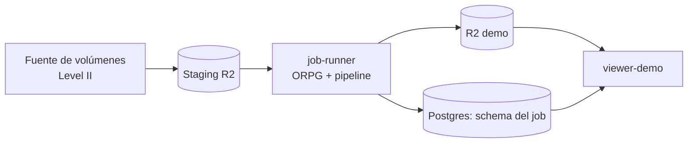

# LAMULA Jobs

Demo bajo demanda de la suite LAMULA completa: un cliente elige una secuencia de
observaciones Level II, nosotros las pasamos por un **ORPG real** (CODE B24.0r1.20, el mismo
software que corre en un WSR-88D operativo), y la salida entra por el pipeline de
`nexrad-l3-pipeline` hasta un espacio dedicado del `lamula-webviewer` donde el cliente ve sus
productos.

Lo que el demo público de `nexrad-l3-pipeline` enseña hoy son productos Level III que **ya
venían hechos** desde el feed de Unidata. Esto enseña la cadena entera: base data cruda →
generación de productos → almacenamiento → visualización. Es decir, el producto que se vende,
no una parte de él.

Empieza por [Contexto y alcance](alcance/contexto.md), sigue por
[Decisiones de diseño](alcance/decisiones.md).

!!! danger "La Fase 0 sigue sin ejecutarse"
    Nadie ha automatizado todavía `nbtcp` ni ha comprobado que un volumen de AWS recorre la
    cadena entera, así que el diseño sigue siendo papel. Ver [Fases](implementacion/fases.md).

    Lo que sí está hecho, sin contenedor: el catálogo está medido
    ([Catálogo verificado](referencia/catalogo-verificado.md)), y una de las puertas de F0 ya
    tiene respuesta parcial —un producto sin encabezado WMO rompe el pipeline,
    [Contrato con el pipeline](referencia/contrato-pipeline.md)—. Las herramientas están en
    `f0/`.
